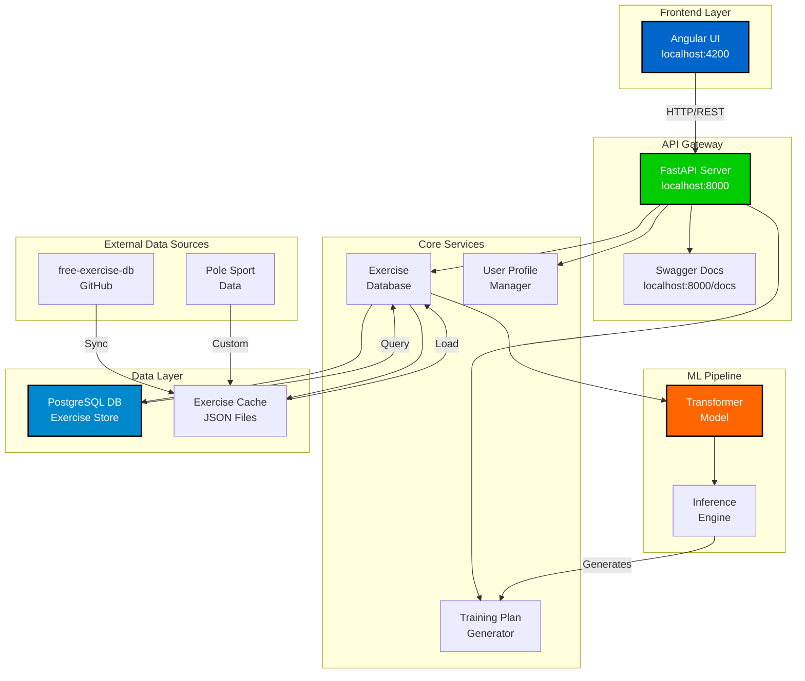

# Architecture & System Design

## System Overview



---

## Component Architecture

### 1. Frontend (Angular)

```
frontend/
├── src/
│   ├── app/
│   │   ├── components/          # UI Components
│   │   │   ├── training-plan/
│   │   │   ├── exercise-list/
│   │   │   └── user-profile/
│   │   ├── services/            # HTTP Services
│   │   │   ├── training-plan.service.ts
│   │   │   └── exercise.service.ts
│   │   ├── models/              # TypeScript Models
│   │   └── app.component.ts
│   └── styles.scss
```

**Responsibilities:**
- User input collection
- Training plan visualization
- Exercise database browsing
- Real-time feedback

---

### 2. Backend (FastAPI)

```
backend/
├── main.py                      # Application entry point
├── manage.py                    # CLI management
├── app/
│   ├── api/                     # API Routes
│   │   ├── training_plans.py    # Training plan endpoints
│   │   └── exercises.py         # Exercise management endpoints
│   ├── models/                  # SQLAlchemy Models
│   │   └── __init__.py         # Exercise, TrainingPlan, etc.
│   ├── core/                    # Core services
│   │   ├── database.py         # DB connection
│   │   ├── data_loader.py      # Exercise import
│   │   └── cli.py              # CLI commands
│   └── services/                # Business logic
└── requirements.txt
```

**Key Responsibilities:**
- RESTful API endpoints
- Database management
- Data import/export
- Training plan generation coordination

---

### 3. Machine Learning Pipeline

```
ml/
├── config.py                    # ML Configuration
├── model.py                     # Neural network
├── train.py                     # Training script
├── inference.py                 # Inference engine
├── data/
│   ├── exercises.json          # General exercises
│   └── pole_sport_moves.py      # Pole specific data
└── models/
    └── pole_trainer_v1.pth      # Trained weights
```

**Architecture:**
- Input: User profile (age, level, fitness, goals)
- Encoding: Transformer-based encoder
- Processing: Attention mechanism
- Output: Training plan sequences

---

## Data Flow

### Training Plan Generation

```
┌─────────────────────────────────────────────────────┐
│ User Input (Frontend)                               │
│ - Age, Experience Level, Fitness Level              │
│ - Available Days Per Week                           │
│ - Goals (Strength, Flexibility, New Moves)          │
└──────────────────┬──────────────────────────────────┘
                   │
                   ▼
┌─────────────────────────────────────────────────────┐
│ FastAPI Backend                                     │
│ POST /api/v1/training-plans/generate                │
└──────────────────┬──────────────────────────────────┘
                   │
                   ▼
┌─────────────────────────────────────────────────────┐
│ User Profile Preprocessing                          │
│ - Normalize inputs                                  │
│ - Create embeddings                                │
└──────────────────┬──────────────────────────────────┘
                   │
                   ▼
┌─────────────────────────────────────────────────────┐
│ ML Model (Inference)                                │
│ - Transformer Encoder                              │
│ - Attention Mechanism                              │
│ - Sequence Generation                              │
└──────────────────┬──────────────────────────────────┘
                   │
                   ▼
┌─────────────────────────────────────────────────────┐
│ Exercise Selection & Assembly                       │
│ - Query Exercise Database                          │
│ - Select appropriate exercises                     │
│ - Validate progression                             │
└──────────────────┬──────────────────────────────────┘
                   │
                   ▼
┌─────────────────────────────────────────────────────┐
│ Training Plan Response (Frontend)                   │
│ - Exercises with reps/sets/duration                │
│ - Progression schedule                             │
│ - Safety tips                                      │
└─────────────────────────────────────────────────────┘
```

---

## Database Schema

```mermaid
erDiagram
    USER_PROFILE ||--o{ TRAINING_PLAN : creates
    TRAINING_PLAN ||--|{ TRAINING_PLAN_EXERCISE : contains
    TRAINING_PLAN_EXERCISE }o--|| EXERCISE : uses
    EXERCISE }o--o{ POLE_SPORT_MOVE : related_to
    
    USER_PROFILE {
        string id PK
        string user_id UK
        int age
        string pole_sport_level
        int fitness_level
        int available_days_per_week
        json goals
        json injuries
        datetime created_at
    }
    
    TRAINING_PLAN {
        string id PK
        string user_id FK
        string name
        int duration_weeks
        string focus_area
        string difficulty_level
        datetime created_at
        boolean is_active
    }
    
    EXERCISE {
        string id PK
        string name
        string category
        string level
        string equipment
        json primary_muscles
        json secondary_muscles
        json instructions
        boolean is_pole_sport
        string source
        datetime created_at
    }
    
    TRAINING_PLAN_EXERCISE {
        string id PK
        string training_plan_id FK
        string exercise_id FK
        int duration_minutes
        int sets
        int repetitions
        int rest_seconds
        string intensity
        int order
    }
    
    POLE_SPORT_MOVE {
        string id PK
        string name
        string level
        json prerequisites
        json progression_steps
        json primary_muscles
        json conditioning_exercises
        json safety_tips
        datetime created_at
    }
```



---

## Data Sources Integration

### 1. free-exercise-db Integration

```
GitHub Repository
└── /dist/exercises.json
    │
    ├─ Fetch (HTTP Request)
    │
    └─ Local Cache
        │
        └─ Data Loader
            │
            └─ PostgreSQL Database
```

**Update Strategy:**
- Automatic fetch on first run
- Manual sync with CLI: `python manage.py fetch-exercises`
- Caching to `ml/data/exercises.json`
- Deduplication on import

### 2. Pole Sport Custom Data

```
Pole Sport Moves (Defined in Code)
└── pole_sport_moves.py
    │
    ├─ Basic Moves (grip, sit)
    ├─ Intermediate (spin, flexibility)
    └─ Advanced (invert, shoulder mount)
    │
    └─ Data Loader
        │
        └─ PostgreSQL Database
```

### 3. User-Generated Data

```
Frontend User Input
└── Training Plan Generation
    │
    ├─ Exercise Selection
    ├─ Progress Tracking
    └─ Performance Feedback
    │
    └─ Database Storage
```

---

## API Contract

### Request/Response Flow

**Incoming Request:**
```json
{
  "age": 28,
  "experience_level": "intermediate",
  "fitness_level": 7,
  "available_days_per_week": 4,
  "goals": ["strength", "new_moves"]
}
```

**Processing:**
1. Validate user input
2. Create user profile embedding
3. Run ML inference
4. Select exercises from database
5. Assemble training plan
6. Store in database

**Response:**
```json
{
  "id": "plan_12345",
  "user_id": "user_789",
  "name": "Beginner's Strength Foundation",
  "duration_weeks": 4,
  "focus_area": "Upper Body Strength",
  "difficulty_level": "intermediate",
  "exercises": [
    {
      "exercise_id": "pole_basic_grip",
      "name": "Basic Pole Grip",
      "duration_minutes": 10,
      "sets": 3,
      "repetitions": 12,
      "intensity": "medium",
      "instructions": ["..."]
    },
    {
      "exercise_id": "push_ups",
      "name": "Push Ups",
      "duration_minutes": 15,
      "sets": 3,
      "repetitions": 10,
      "intensity": "medium"
    }
  ],
  "created_at": "2026-06-11T10:30:00Z"
}
```

---

## Deployment Architecture

### Development
```
localhost:4200 (Frontend)
│
└── localhost:8000 (Backend + API)
    │
    └── SQLite Database (pole_ai.db)
```

### Production (Docker Compose)
```
Nginx (Reverse Proxy)
├── Port 80 → Frontend (Angular)
├── Port 8000 → Backend (FastAPI)
└── PostgreSQL
    └── Database
```

---

## Security Considerations

1. **Authentication**: JWT tokens (TODO)
2. **Authorization**: Role-based access control
3. **Data Validation**: Pydantic models with validation
4. **CORS**: Configured for frontend domain
5. **Environment Variables**: Secrets in .env
6. **SQL Injection**: SQLAlchemy ORM protects
7. **Rate Limiting**: TODO - Implement rate limits

---

## Performance Optimization

1. **Database Indexing**:
   - On `category`, `level`, `is_pole_sport`
   - On `user_id` for quick lookups

2. **Caching**:
   - Exercise data cached in JSON files
   - Could add Redis for training plans

3. **Query Optimization**:
   - Pagination in all list endpoints
   - Lazy loading of relationships

4. **ML Model**:
   - Batch inference for multiple users
   - GPU acceleration (optional)

---

## Future Enhancements

1. **Real-time Updates**: WebSocket for progress tracking
2. **Advanced Analytics**: User progress dashboard
3. **Personalization**: Fine-tuned models per user
4. **Community Features**: Share training plans
5. **Mobile App**: React Native or Flutter
6. **Video Integration**: Exercise demonstration videos
7. **Wearable Integration**: Fitness tracker sync
